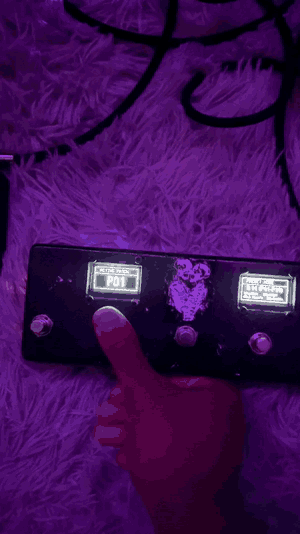
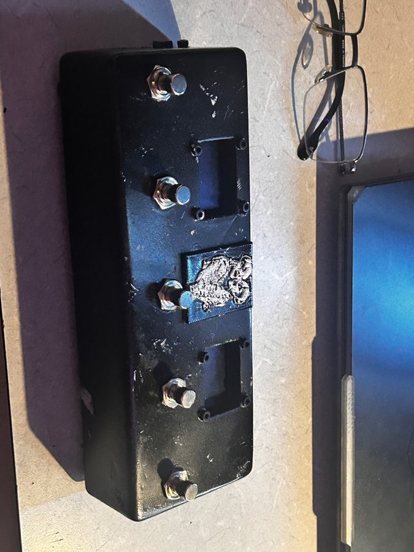
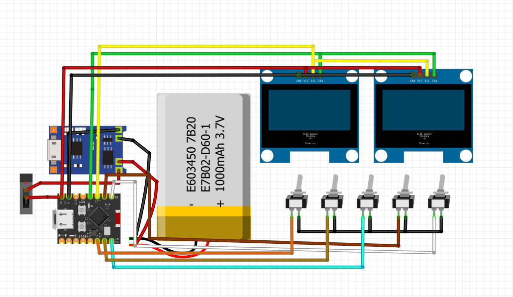
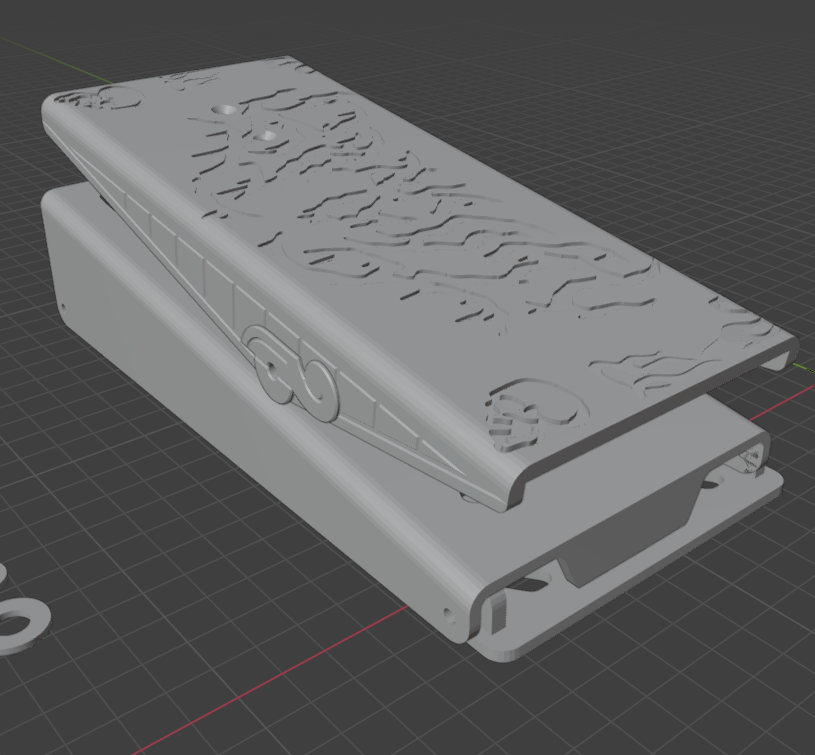
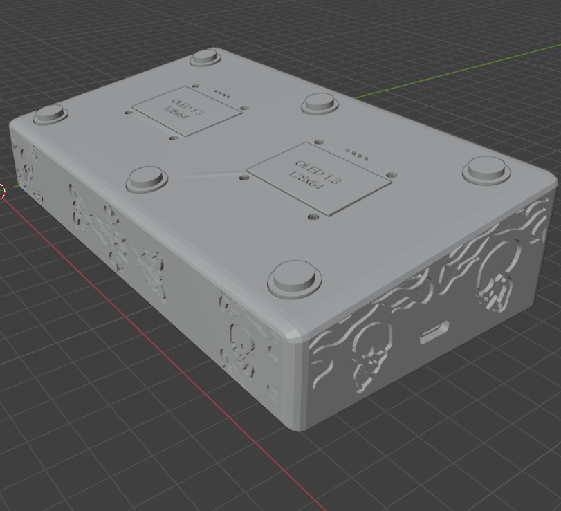

# Cortex-Command

  

A DIY **USB MIDI foot controller** built on the **Arduino Pro Micro (ATmega32U4)** — featuring **6 footswitches**, **dual OLED status screens**, and a **TRS expression (wah) input**.

> Goal: a rugged, stage-friendly controller that speaks native USB MIDI and feels like a real piece of gear, not a science fair project.

**v2** is a wireless, battery-powered rebuild on an **ESP32-C3** that controls a **Sonicake Pocket Master** over **Bluetooth LE MIDI**. [Jump to v2](#v2-wireless-ble-midi-esp32-c3).

<table align="center">
  <tr>
    <td align="center">
      
    </td>
    <td align="center">
      
    </td>
  </tr>
</table>

---
## v2: Wireless BLE MIDI (ESP32-C3)

  
   
  <a href="images/v2/v2-demo.mp4">▶ Watch the full demo with the Pocket Master (MP4)</a>

v2 drops the USB cable. It runs on an **ESP32-C3 SuperMini**, advertises itself as the Bluetooth LE MIDI device `PocketMaster-Ctrl`, and controls a **Sonicake Pocket Master** multi-effects pedal using the CC numbers from the pedal's manual. Tested in practice sessions with the Pocket Master.

### Hardware
| Part | Details |
|---|---|
| Microcontroller | ESP32-C3 SuperMini (Bluetooth LE) |
| Power | 1000 mAh 3.7 V LiPo, TP4056 USB charging module, slide power switch |
| Displays | 2× 1.3" SH1106 128×64 OLED on one I2C bus (SDA GPIO 4, SCL GPIO 3, addresses 0x3C / 0x3D) |
| Footswitches | 5 momentary switches with internal pull-ups: GPIO 1, 0, 10, 20, 21 |
| Expression input | GPIO 2 (ADC1, 12-bit) |

  

### Controls
Each switch has a **tap** action and a **hold** action (held for 800 ms), so 5 switches cover two modes.

| Switch | Preset mode (tap) | Stomp mode (tap) | Hold |
|---|---|---|---|
| SW1 | Previous preset (CC 24) | Drive on/off (CC 45) | Switch between preset and stomp mode |
| SW2 | Next preset (CC 25) | Delay on/off (CC 50) | Next bank of 10 presets (preset mode) |
| SW3 | Slot 1 of current bank (CC 1) | Mod/FX2 on/off (CC 49) | — |
| SW4 | Slot 2 of current bank (CC 1) | Reverb on/off (CC 51) | — |
| SW5 | Slot 3 of current bank (CC 1) | Tuner on/off (CC 58) | — |

### Expression pedal processing
The expression input controls preset volume (CC 7, 0–100):
1. Sampled every 15 ms (about 66 Hz) to limit Bluetooth traffic
2. Smoothed with an exponential moving average to remove ADC jitter
3. Clamped to calibrated heel and toe limits to absorb pedal gear slack
4. Shaped with a squared (audio-taper) curve for a natural volume swell
5. Sent only when the value changes

### Firmware
**[`/firmware-esp32-ble/firmware-esp32-ble.ino`](firmware-esp32-ble/firmware-esp32-ble.ino)**

Built with the Arduino ESP32 core. Libraries: **U8g2**, **BLE-MIDI** (`BLEMIDI_Transport`) and the **MIDI Library** it depends on.

### Known limitations
- Switch inputs rely on loop timing instead of a dedicated debounce.
- Previous/next preset use relative commands while the display tracks its own count, so changing presets on the pedal itself puts the display out of sync.
- Stomp on/off states start as OFF at boot and are not read back from the pedal.
- The boot-time jump to P01 is sent before a Bluetooth connection exists.
- No battery voltage monitoring yet.

---
## CREDITS TO:
Adafruit Midi Expression Pedal Overview, i sourced their 3d files for the foot pedal and made lots of changes to it. Code needed to be done in C++ since I was using a different microcontroller.
https://learn.adafruit.com/midi-foot-pedal/
---

## Features
- **Native USB MIDI** via ATmega32U4 (no extra MIDI interface needed)
- **6 momentary footswitches** (INPUT_PULLUP wiring)
- **2× 1.3" I2C OLED displays** (shared bus, different I2C addresses)
- **Expression pedal input** over **TRS** (Tip = 5V, Ring = signal, Sleeve = GND)
- Modular build: main controller + separate expression pedal enclosure (3D FILES ARE INCLUDED /3D files)

---

## Project Gallery / Build Snapshots

**Main controller enclosure**

- Top view / pedal-style layout            - Bottom view / component layout  

    <td align="center">
      
    </td>
    <td align="center">
      
    </td>
  </tr>
</table>

---

## Bill of Materials (BOM)

| Qty | Part |
|---:|---|
| 6 | 12mm Momentary Push Button (SPST, ON/OFF) |
| 2 | TRS 1/4" Female Jack |
| 1 | 1/4" cable (3 ft) |
| — | Dupont wires |
| 2 | 1.3" OLED I2C 128×64 (SH1106 / “12864”) |
| — | Assorted M3 screws |
| 1 | Arduino Pro Micro (ATmega32U4, USB-C) |
| 1 | WH148 Type B10K linear potentiometer (expression pedal) |

---

## Hardware Wiring (Fritzing Diagrams)

This section documents the **final physical wiring** of Cortex Command using Fritzing diagrams.
All images are stored locally in the `/images` directory and reflect the exact build.

---

## OLED Displays (Dual I2C)

Two 1.3" OLED displays are connected on a shared I2C bus.

**Connections**
- SDA → D2  
- SCL → D3  
- VCC → 5V  
- GND → GND  

⚠️ Each display must have a **unique I2C address**:
- Display 1 → `0x3C`
- Display 2 → `0x3D`

---

## Expression / Wah Pedal (TRS)

The expression pedal connects via a **1/4\" TRS jack** and uses a B10K linear potentiometer
configured as a voltage divider.

**TRS Mapping**
- Tip → +5V (VCC)
- Ring → Analog Signal (A0)
- Sleeve → Ground (GND)

This allows the pedal to output a stable **0–5V signal** into analog pin A0.

(FOR OVERALL EXPRESSION PEDAL ASSEMBLY ITS WELL DOCUMENTED IN THE ADAFRUIT WEBSITE: https://learn.adafruit.com/midi-foot-pedal/)

---

## Footswitches (6× Momentary Buttons)

All six footswitches use the Arduino `INPUT_PULLUP` configuration.

**Wiring Method**
- One terminal → Digital input pin
- One terminal → Common GND
- Pressed = LOW

**Pin Assignments**
| Button | Pin | MIDI CC |
|------:|-----|---------|
| 1 | D4 | CC 101 |
| 2 | D6 | CC 102 |
| 3 | D7 | CC 103 |
| 4 | D8 | CC 104 |
| 5 | D9 | CC 105 |
| 6 | D10 | CC 106 |

---

## Firmware

The Arduino sketch handling:
- USB MIDI
- Button scanning with press-edge detection
- Expression pedal analog input
- OLED rendering

is located here:

 **[`/firmware/sketch_midi.ino`](firmware/sketch_midi.ino)**

(Requires an Arduino Pro Micro / ATmega32U4 for native USB MIDI support.)

---

## Notes
- All grounds are tied to a **single common GND**
- OLED instability usually indicates:
  - Incorrect I2C address
  - SDA/SCL swapped
  - Weak USB power source
 
<h2 align="center">Display Demo</h2>

  <a href="images/Display%20Video.mp4">▶ Watch the display demo (MP4)</a>

